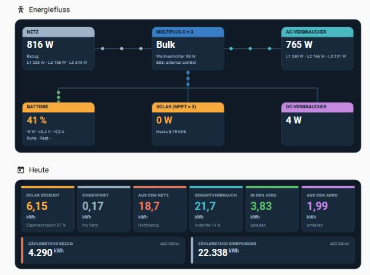
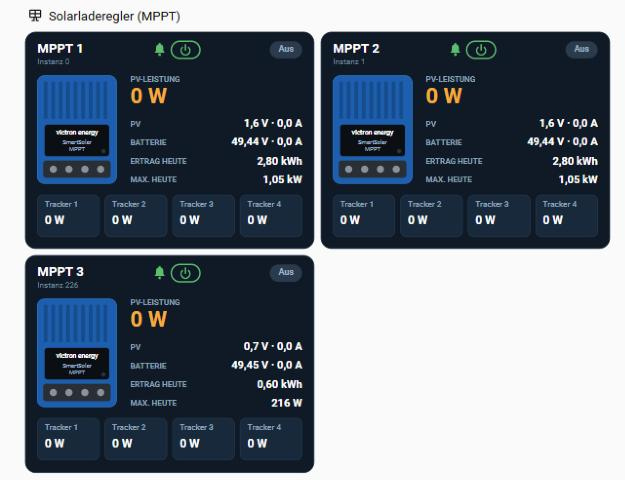
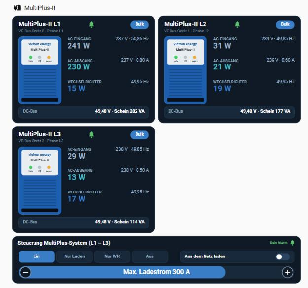
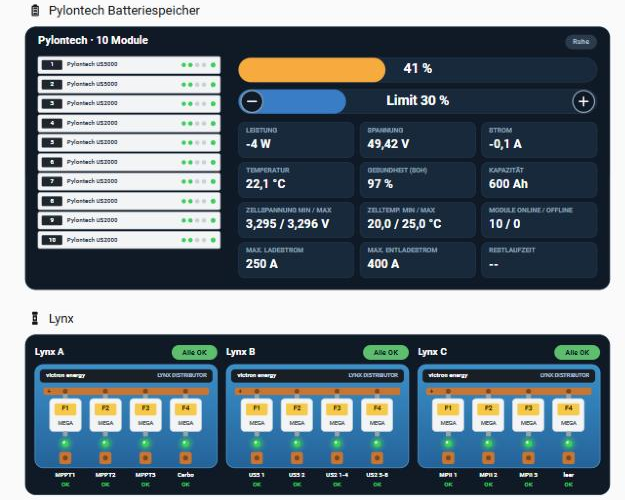
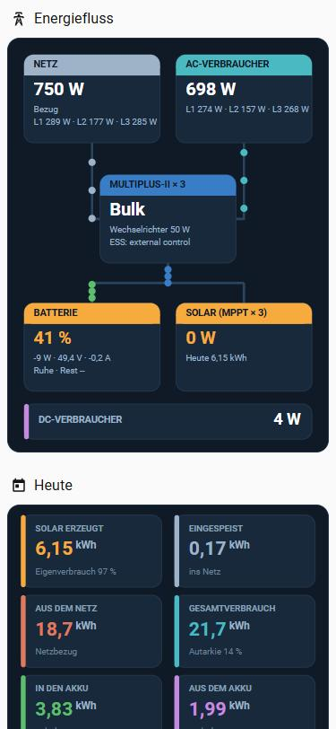
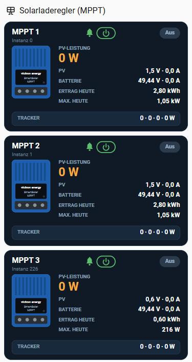
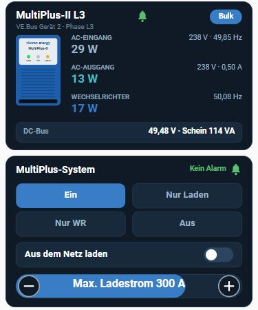
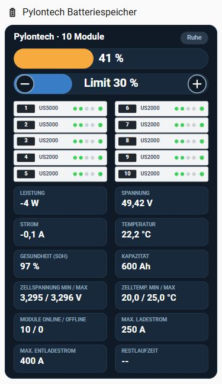
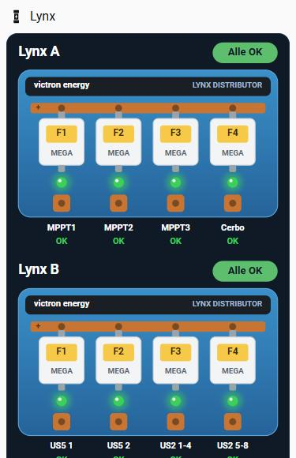

# Solar Übersicht V1 – Home-Assistant-Dashboard im Victron-Stil

> Dies ist die erste Version (Stand 18.10.2026). Die aktuelle Version mit Einzelwerten je Pylontech-Modul und Mindest-SoC-Schieberegler liegt in [`../V2`](../V2).

Ein Dashboard für Home Assistant, das eine Victron-Anlage mit Pylontech-Speicher übersichtlich darstellt – angelehnt an den Look von Victron VRM. Alle Grafiken (Energiefluss, MPPT, MultiPlus, Akku-Stapel, Lynx-Verteiler) werden live als SVG gezeichnet; es werden keine Bilddateien benötigt.

Jede Karte gibt es zweimal: eine **Desktop-Variante** (ab 768 px Breite) und eine eigene **Handy-Variante**, die Home Assistant automatisch je nach Bildschirmbreite zeigt.

## Energiefluss in Bewegung


*Demo mit Beispielwerten (sonniger Mittag): Die Solaranlage liefert 4,23 kW, davon gehen 1,79 kW in den Akku, das Haus verbraucht 1,57 kW und 650 W werden ins Netz eingespeist. Die Punkte zeigen die Flussrichtung, und je mehr Leistung fließt, desto schneller laufen sie.*

<details>
<summary>Handy-Ansicht</summary>


</details>

## Ansichten

### Normale Ansicht (Desktop / Tablet)

| | |
|---|---|
|  |  |
|  |  |

### Handy

| | | | | |
|---|---|---|---|---|
|  |  |  |  |  |

*Screenshots aus der laufenden Anlage.*

## Was das Dashboard zeigt

| Bereich | Inhalt |
|---|---|
| **Energiefluss** | Netz, MultiPlus, AC-Verbraucher, Batterie, Solar und DC-Verbraucher. Bewegte Punkte zeigen die Flussrichtung, die Geschwindigkeit richtet sich nach der Leistung. |
| **Heute** | Solar erzeugt, eingespeist, aus dem Netz, Gesamtverbrauch, in den / aus dem Akku – dazu Eigenverbrauch, Autarkie und die Zählerstände Bezug / Einspeisung. |
| **Solarladeregler (MPPT)** | Je Laderegler: Zustand, PV-Leistung, PV- und Batteriespannung/-strom, Ertrag und Maximum heute, Leistung der 4 Tracker. Alarmglocke (grün / orange / rot) und Ein/Aus-Knopf. |
| **MultiPlus-II** | Je Phase L1–L3: AC-Eingang, AC-Ausgang, Wechselrichterleistung, Frequenz, DC-Bus, Scheinleistung und Alarmglocke. |
| **Steuerung MultiPlus-System** | Betriebsart Ein / Nur Laden / Nur WR / Aus, „Aus dem Netz laden“ (ESS Force charge), max. Ladestrom (DVCC) mit −/+. |
| **Pylontech Batteriespeicher** | 10 Module (2× US5000, 8× US2000) mit SOC-LEDs, SOC-Balken, einstellbarer Mindest-SoC (ESS), Leistung, Spannung, Strom, Temperatur, SoH, Kapazität, Zellwerte, Lade-/Entladegrenzen, Restlaufzeit. |
| **Lynx** | 3 Lynx Distributor mit je 4 MEGA-Sicherungen und Beschriftung. LED grün = OK, rot blinkend = defekt. |

Alle Schaltflächen fragen vor dem Schalten nach.

## Voraussetzungen

- Home Assistant 2026.x mit einem **Sections**-Dashboard
- [**button-card**](https://github.com/custom-cards/button-card) (über HACS installieren)
- Victron-Daten in Home Assistant – hier über die Integrationen **victron_mqtt** (`gx_device_*`, `multiplus_ii_1_*`) und **Victron (Modbus)** (`victron_*`)
- Pylontech-Werte (hier: `pylontech_battery_id_512_*`)
- Lynx-Sicherungsstatus über ein eigenes ESPHome-Gerät (`binary_sensor.lynx_monitor_lynx_a…c_fuse_1…4_broken`)

## Installation

1. **button-card** über HACS installieren und den Browser neu laden.
2. **Hilfswert anlegen:** Einstellungen → Geräte & Dienste → Helfer → Helfer erstellen → **Zahlenwert**
   - Name: `Solar Ziel Ladestrom` (ergibt `input_number.solar_ziel_ladestrom`)
   - Minimum `-1`, Maximum `1000`, Schrittweite `1`, Einheit `A`, Anzeige: Eingabefeld
3. **Automationen anlegen:** Den Inhalt von [`automations.yaml`](automations.yaml) übernehmen – entweder in die eigene `automations.yaml` einfügen oder jede Automation im Editor über „In YAML bearbeiten“ einfügen (dann die `id`-Zeile weglassen).
4. **Dashboard anlegen:** Einstellungen → Dashboards → Dashboard hinzufügen → „Neues Dashboard von Grund auf“. Dashboard öffnen → ✏️ → ⋮ → **Raw-Konfigurationseditor** → den kompletten Inhalt von [`solar-uebersicht.yaml`](solar-uebersicht.yaml) einfügen und speichern.
5. **Entitäten anpassen:** Die Entitäts-IDs passen zu dieser Anlage. Bei einer anderen Anlage im Raw-Editor mit Suchen & Ersetzen anpassen (siehe unten).

## Wie es funktioniert

- **Vorlagen statt Einzelkarten:** Unter `button_card_templates` liegen die Bausteine. `vic_base` enthält die Hilfsfunktionen (Formatierung, SVG-Text, Rechtecke, Gerätegrafiken `MPPT`, `MULTI`, `MODULE`, Alarmglocke `BELL`, Ein/Aus-Symbol `PWR`). Die übrigen Vorlagen (`vic_flow`, `vic_energy`, `vic_mppt`, `vic_multi`, `vic_mpctl`, `vic_pylon`, `vic_lynx`) bauen daraus jeweils eine Karte.
- **Desktop / Handy:** Jede Karte steht zweimal im Dashboard, einmal mit `variables: {m: true}`. Über `visibility` mit `screen`-Bedingung (`min-width: 768px` / `max-width: 767px`) zeigt Home Assistant die passende.
- **Schaltflächen:** Die SVG-Grafik selbst ist nicht anklickbar. Über jedem Knopf liegt eine unsichtbare button-card (`custom_fields` mit Präfix `t_`, Vorlage `vic_tap`), die per Prozentangabe genau auf das gezeichnete Symbol gesetzt ist.
- **Geräte pro Karte:** Die MPPT-Karten bekommen `variables: {id: "0" | "1" | "226", name: …}`, die MultiPlus-Karten `variables: {ph: "l1" | "l2" | "l3", dev: "0" | "1" | "2", name: …}`.
- **Sicherungsnamen:** In `vic_lynx` unter `variables.names` (je Lynx A/B/C eine Liste mit 4 Namen, max. ca. 12 Zeichen).

### Warum ein Hilfswert für den Ladestrom?

Der Cerbo meldet einen geänderten Ladestrom erst nach einigen Sekunden zurück und ignoriert gelegentlich einen Schreibbefehl. Deshalb ändern −/+ zuerst sofort `input_number.solar_ziel_ladestrom` – die Anzeige reagiert direkt und ist orange, bis der Cerbo bestätigt.

- **„Solar: Ziel-Ladestrom an Cerbo übertragen“** schreibt den Wert 1 s nach dem letzten Tippen an den Cerbo und wiederholt es bis zu 3-mal, falls er nicht übernommen wird.
- **„Solar: Ziel-Ladestrom mit Cerbo abgleichen“** zieht den Hilfswert nach, wenn der Ladestrom woanders (VRM, Cerbo-Display) geändert wird.

## Verwendete Entitäten (Auswahl)

| Zweck | Entitäten |
|---|---|
| Netz / Verbrauch | `sensor.gx_device_netz_leistung_l1…l3`, `sensor.gx_device_verbrauch_leistung_l1…l3` |
| PV / Batterie gesamt | `sensor.victron_system_dc_pv_power`, `sensor.victron_system_battery_power/_soc/_voltage/_current/_state/_time_to_go` |
| MPPT | `sensor.victron_solarcharger_*_{0,1,226}`, `select.victron_solarcharger_mode_{0,1,226}` |
| MultiPlus | `sensor.multiplus_ii_1_wechselrichter_*_l1…l3`, `sensor.multiplus_ii_1_ve_bus_gerat_{0,1,2}_inverter_leistung`, `sensor.victron_vebus_state_227`, `sensor.victron_vebus_alarm_*_227` |
| Steuerung | `select.victron_vebus_mode_227`, `switch.ess_force_charge`, `number.gx_device_ess_max_ladestrom`, `input_number.solar_ziel_ladestrom` |
| Tageswerte | `sensor.gx_device_solar_erzeugung_taglich`, `sensor.vrm_today_grid_energy_in/_out`, `sensor.vrm_today_consumption`, `sensor.gx_device_batterie_in`, `sensor.gx_device_baterie_out` |
| Zählerstände | `sensor.stromleser_ebz_e_inop`, `sensor.stromleser_ebz_e_outop` |
| Pylontech | `sensor.pylontech_battery_id_512_*`, `number.gx_device_ess_mindest_soc_grenze`, `sensor.gx_device_active_soc_limit` |
| Lynx | `binary_sensor.lynx_monitor_lynx_{a,b,c}_fuse_{1…4}_broken` |

## Dateien

```
solar-uebersicht.yaml   Dashboard (für den Raw-Konfigurationseditor)
automations.yaml        die zwei Automationen für den Ladestrom
docs/                   Screenshots Desktop und Handy
```
